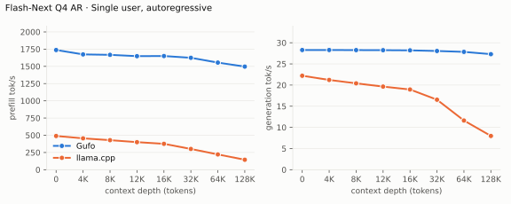
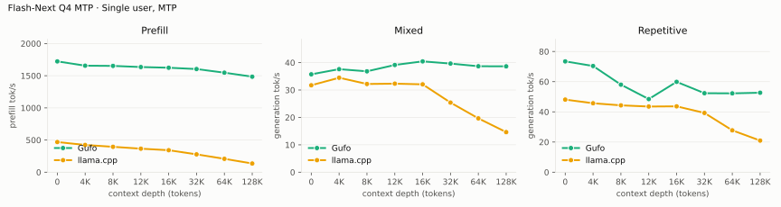
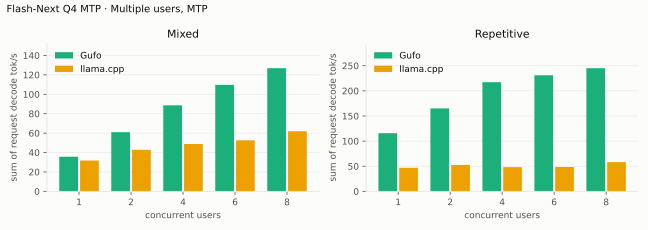
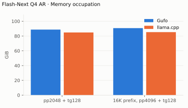
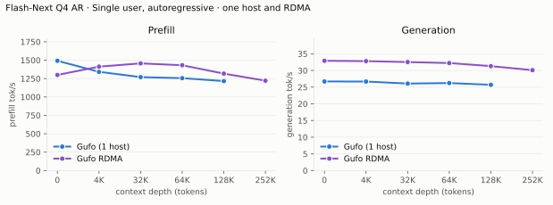
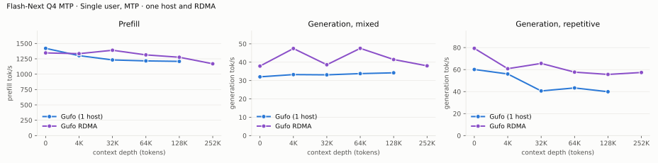
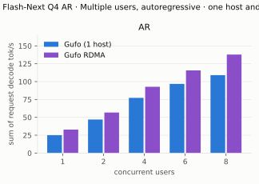
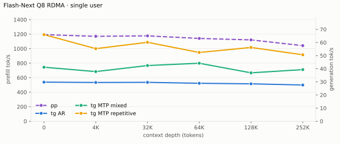
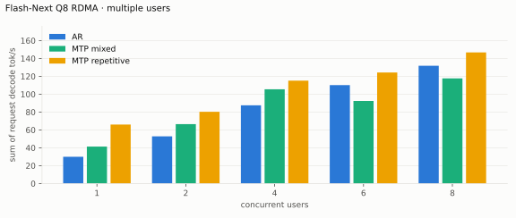

# Qwen3.8 Flash-Next benchmarks

AMD Strix Halo `gfx1151`, 128 GB unified memory. Unsloth `UD-Q4_K_XL` target and
shared-Q8_0 MTP sidecar; Gufo uses adaptive MTP. HTTP, greedy, thinking off.
Positive gain favors Gufo.
[Quality and measurement details](QUALITY.md#benchmark-method) · [Model identities](artifacts/model-identities.json)

- [Single Strix Halo](#single-strix-halo): Gufo against llama.cpp.
- [Two Strix Halos over RDMA](#two-strix-halos-over-rdma): Gufo-TP against
  Gufo on one host, deeper contexts, and the full Q8 model.

## Single Strix Halo

All Gufo tables measured October 18, 2026, with `fec4759d` and the
validated host-memory and cache-stall fixes.

The focused October 21 follow-up is separate.
Reference results remain unchanged from September 22–23.
llama.cpp uses `b11069` for AR and `6fcaa16f` for MTP.

Gufo numerical regression checks pass; individual functional timing limits
remain documented in [QUALITY.md](QUALITY.md). Historical llama.cpp MTP values are retained as requested:
a separate check of that pin did not match its own AR output, so this review
does not requalify those comparisons. [Review evidence](artifacts/decode-kernels-review.json).

At 128K, Gufo reaches 1557.18 tok/s AR prefill and 1481.19 tok/s MTP prefill.
All 24 single-user rows match the previous qualified capture in completion
hashes and prompt/cache counts.
All 63 concurrent tg128 completions match the corresponding C1 AR control.
Repetitive MTP through 64K reports mean ± sample standard deviation across
the sweep and one focused repeat. Initial PP dips at 16K/32K/64K did not
repeat against current main; both observations remain included.
Prior mixed MTP C2 repeats show two draft-controller trajectories (about 54
and 60 tok/s, identical text), so its gain is not entirely attributable to lookup.

## Sampled decode follow-up, October 21

Focused production comparison against main `0c03748a`, candidate `1d3b8c68`,
with the same Nix toolchain, weights and ordered request histories. Model
defaults are used for sampled requests; concurrency is physical, and the C>1
rates sum the individual decode rates. These measurements qualify the decode
changes separately from the complete October 18 tables below. They do not
refresh the reference data.

| Workload | Main tok/s | Candidate tok/s |
| --- | ---: | ---: |
| Copy existing code, default sampling, C1 | 109.59 | 112.30 |
| Generate new code, default sampling, C1 | 75.18 | 75.40 |
| Generate prose, default sampling, C1 | 39.74 | 39.76 |
| Thinking/code, default sampling, C1 | 51.93 | 52.05 |
| Greedy code control, C1 | 70.42 | 70.51 |
| Default-sampled copying, C2 aggregate | 132.93 | 135.45 |

These 128-token screens retain identical outputs and prompt/cache counts;
all 276 matched request/phase measurements pass the 5% and 3 ms gate. The
screens measure speed, not complete coding-task accuracy.

Earlier complete-workflow and mixed-cohort checks against main `da5d5a2b`,
before rebasing onto the merged small-prefill changes, remain separate:

| Workload | Main tok/s | Candidate tok/s |
| --- | ---: | ---: |
| Extraction with thinking, 726 tokens | 82.52 | 82.76 |
| Generate and execute URI tests, 441 tokens | 78.54 | 78.79 |
| File-edit tool call at 32K, thinking off | 76.42 | 77.01 |
| File-edit tool call at 32K, thinking on | 72.40 | 72.47 |
| Mixed greedy/default-sampled copying, C2 | 137.63 | 139.50 |
| Mixed greedy/default-sampled copying, C4 | 200.22 | 202.94 |
| Mixed greedy/default-sampled copying, C6 | 218.78 | 221.54 |
| Mixed greedy/default-sampled copying, C8 | 237.34 | 240.87 |

All outputs in these matched captures agree. The extraction, URI and file-edit
fixtures check their actual results. A real Pi conversation also passes, with ten
successful tool calls and executed assertions; its unseeded run is correctness
evidence, not a matched speed claim.

Canonical greedy pp2048/tg128 spots on current main and candidate use the
original single-user context capacity and cache preparation:

| Mode | Cached depth | Main PP | Candidate PP | Main TG | Candidate TG |
| --- | ---: | ---: | ---: | ---: | ---: |
| AR | 0 | 1793.17 | 1792.97 | 28.87 | 28.88 |
| AR | 32,768 | 1651.93 | 1650.85 | 28.74 | 28.77 |
| MTP mixed | 0 | 1724.11 | 1727.57 | 36.18 | 36.31 |
| MTP mixed | 32,768 | 1607.67 | 1605.39 | 40.56 | 40.51 |
| MTP repetitive | 0 | 1737.22 | 1733.71 | 118.61 | 120.25 |
| MTP repetitive | 32,768 | 1609.07 | 1609.65 | 113.61 | 115.07 |

Concurrent greedy TG: repetitive C2 166.15 → 170.96, repetitive C8
245.05 → 247.09, mixed C8 133.65 → 134.61 tok/s. All measured concurrent
completions match isolated AR controls.

Mixed C2 remains variable: the current pair is 62.17 → 55.30 tok/s and the
focused reverse-order control is 53.30 → 55.29. The pre-rebase pair was
62.17 → 55.36 and its reverse-order repeat was 53.30 → 64.03. Main proposes
93 versus 39 drafts per response across its current runs; the final candidate
proposes 56 in both. Both builds produce identical text. These observations do
**not** establish a C2 speedup or a confirmed slowdown. Individual cache,
queue and preparation timing flags remain visible in the
[quality record](QUALITY.md#exact-sampled-decode-october-21-2026); no blanket
timing pass is claimed.

## Single user, autoregressive
### Single user, autoregressive

Approximately pp2048 / tg128; depth is the cached prefix in tokens.
Context capacities differ between engines; see the measurement details.

<!-- bench:single-ar -->
| Flash-Next Q4 AR Depth (tokens) | Gufo pp (tok/s) | llama.cpp pp (tok/s) | Gain | Gufo tg (tok/s) | llama.cpp tg (tok/s) | Gain |
| ---: | ---: | ---: | ---: | ---: | ---: | ---: |
| 0 | 1801.01 | 489.59 | +267.9% | 28.29 | 22.20 | +27.4% |
| 4,096 | 1727.95 | 455.24 | +279.6% | 28.27 | 21.21 | +33.3% |
| 8,192 | 1721.41 | 428.85 | +301.4% | 28.27 | 20.40 | +38.6% |
| 12,288 | 1710.64 | 400.21 | +327.4% | 28.21 | 19.64 | +43.6% |
| 16,384 | 1706.86 | 375.89 | +354.1% | 28.25 | 18.95 | +49.1% |
| 32,768 | 1672.60 | 301.31 | +455.1% | 28.18 | 16.54 | +70.4% |
| 65,536 | 1602.93 | 221.94 | +622.2% | 28.09 | 11.62 | +141.7% |
| 131,072 | 1557.18 | 144.78 | +975.5% | 27.85 | 7.98 | +249.0% |
<!-- /bench -->

### Single user, MTP

pp is the highest measured rate per engine and depth across mixed/repetitive
text, including Gufo predictor catch-up.

<!-- bench:single-mtp -->
| Flash-Next Q4 MTP Depth (tokens) | Gufo pp (tok/s) | llama.cpp pp (tok/s) | Gain pp | Gufo tg mixed (tok/s) | llama.cpp tg mixed (tok/s) | Gain mixed | Gufo tg repetitive (tok/s) | llama.cpp tg repetitive (tok/s) | Gain repetitive |
| ---: | ---: | ---: | ---: | ---: | ---: | ---: | ---: | ---: | ---: |
| 0 | 1734.96 ± 0.85 | 468.76 | +270.1% | 35.79 | 31.73 | +12.8% | 116.93 ± 0.10 | 48.12 | +143.0% |
| 4,096 | 1676.83 ± 1.73 | 423.79 | +295.7% | 37.64 | 34.48 | +9.2% | 116.41 ± 0.07 | 45.71 | +154.7% |
| 8,192 | 1669.91 | 394.98 | +322.8% | 36.91 | 32.20 | +14.6% | 114.08 ± 0.01 | 44.31 | +157.5% |
| 12,288 | 1660.54 ± 1.22 | 365.91 | +353.8% | 39.28 | 32.32 | +21.5% | 105.48 ± 0.15 | 43.53 | +142.3% |
| 16,384 | 1635.18 | 341.98 | +378.2% | 40.54 | 32.07 | +26.4% | 113.32 ± 0.23 | 43.66 | +159.6% |
| 32,768 | 1618.63 | 277.61 | +483.1% | 39.97 | 25.41 | +57.3% | 105.38 ± 0.17 | 39.28 | +168.3% |
| 65,536 | 1556.32 | 208.04 | +648.1% | 39.23 | 19.65 | +99.6% | 104.78 ± 0.21 | 27.75 | +277.6% |
| 131,072 | 1481.19 | 135.42 | +993.8% | 39.87 | 14.63 | +172.5% | 108.37 | 20.96 | +417.0% |
<!-- /bench -->

### Multiple users, autoregressive

Same pp2048 prose prompt as single-user d0, tg128, context 4096 per user.
All sessions prefilled before timed decoding; throughput sums individual rates.
llama.cpp re-evaluates its four-token checkpoint tail.

<!-- bench:multi-ar -->
| Flash-Next Q4 AR Users | Gufo AR (tok/s) | llama.cpp AR (tok/s) | Gain |
| ---: | ---: | ---: | ---: |
| 1 | 28.24 | 22.34 | +26.4% |
| 2 | 50.66 | 37.08 | +36.6% |
| 4 | 86.01 | 54.82 | +56.9% |
| 6 | 108.34 | 65.34 | +65.8% |
| 8 | 125.48 | 68.79 | +82.4% |
<!-- /bench -->

### Multiple users, MTP

Same pp2048 mixed/repetitive prompts as single-user d0, tg128, context 4096
per user. All sessions prefilled before timed decoding; rates sum individual
request decode rates. C1 cross-checks the single-user table.

<!-- bench:multi-mtp -->
| Flash-Next Q4 MTP Users | Gufo mixed (tok/s) | llama.cpp mixed (tok/s) | Gain | Gufo repetitive (tok/s) | llama.cpp repetitive (tok/s) | Gain |
| ---: | ---: | ---: | ---: | ---: | ---: | ---: |
| 1 | 35.74 | 31.77 | +12.5% | 116.50 | 46.93 | +148.2% |
| 2 | 61.30 | 42.79 | +43.3% | 165.50 | 52.57 | +214.8% |
| 4 | 88.77 | 48.78 | +82.0% | 218.12 | 48.23 | +352.2% |
| 6 | 109.74 | 52.59 | +108.7% | 231.85 | 48.51 | +377.9% |
| 8 | 127.02 | 61.92 | +105.1% | 245.81 | 58.13 | +322.9% |
<!-- /bench -->

### Loading time

C1, context capacity 262144, MTP. Cold target/sidecar files to HTTP readiness.

<!-- bench:loading -->
| Flash-Next Q4 Target | Gufo ready (s) | llama.cpp ready (s) | Gain |
| --- | ---: | ---: | ---: |
| Q4 | 16.42 | 117.83 | +617.6% |
<!-- /bench -->

### Memory occupation

C1, context capacity 133121, AR. Peak memory reported by HIP.

<!-- bench:memory -->
| Flash-Next Q4 AR Workload | Gufo GiB | llama.cpp GiB | Gain |
| --- | ---: | ---: | ---: |
| pp2048 + tg128 | 88.78 | 84.84 | -4.4% |
| 16K prefix, pp4096 + tg128 | 90.53 | 85.31 | -5.8% |
<!-- /bench -->

## Two Strix Halos over RDMA

Gufo-TP runs one model on two such hosts: every layer is split between them,
and they exchange partial sums over RDMA ([how it works](TP2.md)).
The workloads are those of the one-host tables; "Gufo" is the same build on
one host, and gain is Gufo-TP over it. With twice the memory, single users
also reach depths one host cannot (context capacity 262144). Every RDMA table
was measured on October 9, 2026 (`c85349b5`) over USB4 RoCE v2, with the
same-build one-host runs beside them, in the balanced power mode (85 W
sustained), so prefill is lower than in the one-host tables above; decode is
not power-bound. Over USB4 a fresh 2K prompt prefills more slowly than on one
host; with a cached prefix, prefill gains 3–15%.

### Single user, autoregressive

<!-- bench:single-ar-tp2 -->
| Flash-Next Q4 AR Depth (tokens) | Gufo pp (tok/s) | Gufo-TP pp (tok/s) | Gain | Gufo tg (tok/s) | Gufo-TP tg (tok/s) | Gain |
| ---: | ---: | ---: | ---: | ---: | ---: | ---: |
| 0 | 1492.22 | 1299.73 | -12.9% | 26.71 | 32.91 | +23.2% |
| 4,096 | 1342.09 | 1412.63 | +5.3% | 26.69 | 32.81 | +22.9% |
| 32,768 | 1270.29 | 1456.89 | +14.7% | 26.08 | 32.53 | +24.7% |
| 65,536 | 1255.97 | 1431.71 | +14.0% | 26.23 | 32.23 | +22.9% |
| 131,072 | 1216.31 | 1317.83 | +8.3% | 25.71 | 31.31 | +21.8% |
| 258,048 | — | 1221.33 | — | — | 30.10 | — |
<!-- /bench -->

### Single user, MTP

<!-- bench:single-mtp-tp2 -->
| Flash-Next Q4 MTP Depth (tokens) | Gufo pp (tok/s) | Gufo-TP pp (tok/s) | Gain pp | Gufo tg mixed (tok/s) | Gufo-TP tg mixed (tok/s) | Gain mixed | Gufo tg repetitive (tok/s) | Gufo-TP tg repetitive (tok/s) | Gain repetitive |
| ---: | ---: | ---: | ---: | ---: | ---: | ---: | ---: | ---: | ---: |
| 0 | 1420.72 | 1346.32 | -5.2% | 32.03 | 37.88 | +18.3% | 60.11 | 79.33 | +32.0% |
| 4,096 | 1301.51 | 1333.77 | +2.5% | 33.25 | 47.46 | +42.7% | 56.03 | 60.82 | +8.5% |
| 32,768 | 1231.99 | 1389.59 | +12.8% | 33.11 | 38.62 | +16.6% | 40.61 | 65.63 | +61.6% |
| 65,536 | 1216.20 | 1314.17 | +8.1% | 33.78 | 47.55 | +40.8% | 43.33 | 57.69 | +33.1% |
| 131,072 | 1208.61 | 1275.75 | +5.6% | 34.21 | 41.46 | +21.2% | 39.90 | 55.62 | +39.4% |
| 258,048 | — | 1169.31 | — | — | 38.02 | — | — | 57.38 | — |
<!-- /bench -->

### Multiple users, autoregressive

Same pp2048 prose prompt, tg128, context 4096 per user; every session
prefills before timed decoding. Rates sum individual decode rates.

<!-- bench:multi-ar-tp2 -->
| Flash-Next Q4 AR Users | Gufo AR (tok/s) | Gufo-TP AR (tok/s) | Gain |
| ---: | ---: | ---: | ---: |
| 1 | 25.09 | 32.89 | +31.1% |
| 2 | 46.95 | 56.77 | +20.9% |
| 4 | 77.27 | 92.79 | +20.1% |
| 6 | 96.79 | 115.69 | +19.5% |
| 8 | 109.03 | 137.86 | +26.4% |
<!-- /bench -->

### Multiple users, MTP

Same configuration and preparation as the AR table, with mixed/repetitive
prompts. Every prepared completion, on both topologies and in all modes, matches
its fresh one-user AR control.

<!-- bench:multi-mtp-tp2 -->
| Flash-Next Q4 MTP Users | Gufo mixed (tok/s) | Gufo-TP mixed (tok/s) | Gain | Gufo repetitive (tok/s) | Gufo-TP repetitive (tok/s) | Gain |
| ---: | ---: | ---: | ---: | ---: | ---: | ---: |
| 1 | 32.04 | 37.75 | +17.8% | 60.16 | 74.16 | +23.3% |
| 2 | 53.57 | 66.98 | +25.0% | 84.28 | 113.63 | +34.8% |
| 4 | 77.13 | 92.34 | +19.7% | 124.27 | 160.23 | +28.9% |
| 6 | 96.19 | 108.78 | +13.1% | 134.85 | 176.43 | +30.8% |
| 8 | 106.50 | 127.06 | +19.3% | 149.87 | 191.36 | +27.7% |
<!-- /bench -->

### Full Q8 model

The full Q8_0 target does not fit one host. Single user, pp2048/tg128 by depth
as above; prefill on the left axis, generation on the right.

<!-- bench:tp2-q8 -->
| Flash-Next Q8 RDMA Depth (tokens) | pp (tok/s) | tg AR (tok/s) | tg MTP mixed (tok/s) | tg MTP repetitive (tok/s) |
| ---: | ---: | ---: | ---: | ---: |
| 0 | 1193.06 | 29.80 | 41.15 | 65.99 |
| 4,096 | 1169.94 | 29.52 | 37.83 | 55.31 |
| 32,768 | 1176.27 | 29.64 | 42.44 | 60.15 |
| 65,536 | 1140.63 | 28.91 | 44.19 | 52.40 |
| 131,072 | 1120.59 | 28.50 | 36.88 | 56.22 |
| 258,048 | 1041.67 | 27.60 | 39.34 | 50.64 |
<!-- /bench -->

Multiple users with the configuration and preparation of the Q4 tables:

<!-- bench:tp2-q8-multi -->
| Flash-Next Q8 RDMA Users | AR (tok/s) | MTP mixed (tok/s) | MTP repetitive (tok/s) |
| ---: | ---: | ---: | ---: |
| 1 | 29.97 | 41.33 | 65.99 |
| 2 | 52.82 | 66.48 | 80.25 |
| 4 | 87.52 | 105.45 | 115.17 |
| 6 | 110.17 | 92.40 | 124.27 |
| 8 | 131.79 | 117.69 | 146.72 |
<!-- /bench -->

Q8 MTP rates vary more between server starts than between cohorts of one
start: a second start with three cohorts per point gave mixed 90.06 (C4) and
105.40 (C6), repetitive 115.74 (C4) and 118.65 (C6) tok/s, each cohort within
3% of its point's rate.
